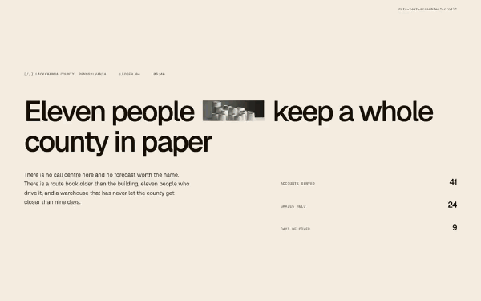
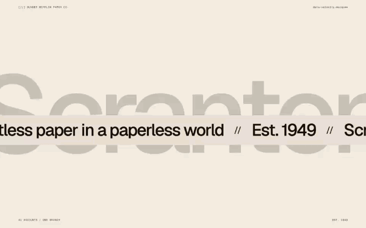
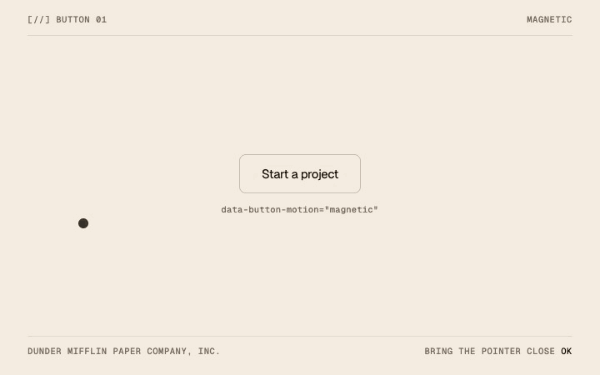

# Moving parts, free components

Five animated components for the web, in plain JavaScript and CSS, under the MIT licence.

I am Benjamin Nespoulous, a designer. I build these effects for my own projects and keep them in a library, [Moving parts](https://movingparts.supply/?from=github). Five of them are free, and this repository is their code, as it ships: readable, not minified, no build step, one attribute to put on an element.

| | Component | What it does | Needs |
|---|---|---|---|
| <a href="https://movingparts.supply/components/text-scramble/?from=github"></a> | [Text scramble](text-scramble/) | Text shuffles through glyphs and settles, on scroll or on hover | nothing |
| <a href="https://movingparts.supply/components/velocity-marquee/?from=github"></a> | [Velocity marquee](velocity-marquee/) | An endless ribbon whose speed, direction and lean follow the page scroll | GSAP 3 |
| <a href="https://movingparts.supply/components/dot-repel/?from=github"></a> | [Dot repel](dot-repel/) | A halftone screen of fine dots behind a hero, parted by the pointer | nothing |
| <a href="https://movingparts.supply/components/button-01/?from=github"></a> | [Button 01](button-01/) | A magnetic button: it leans toward the pointer, then settles back | GSAP 3 |
| <a href="https://movingparts.supply/components/pixel-ribbon/?from=github"></a> | [Pixel ribbon](pixel-ribbon/) | A ribbon of pixels trails the cursor on springs, then folds back in | nothing |

Each preview links to the component's page on the site. To see one run here, open its `demo.html`.

## What is in a folder

| File | What it is |
|---|---|
| `<name>.js` | The engine. Its settings are the `DEFAULTS` block at the top |
| `<name>.css` | The mechanics the engine needs, then the look of the preview, which you can drop |
| `snippet.html` | The markup of the preview, with its attributes |
| `demo.html` | The preview as a page. Open the file in a browser, it runs |
| `README.md` | The settings table and how to use it |

The engines never read a class. On an element of your own, keep your classes and add the attribute.

## Install

### 1. Copy the folder

Take the folder of the component, put it in your project, and link its two files:

```html
<link rel="stylesheet" href="text-scramble/text-scramble.css">

<h1 data-text-scramble="scroll">Eleven people keep a whole county in paper</h1>

<script src="text-scramble/text-scramble.js"></script>
```

The script mounts every marked element when the page is ready. `velocity-marquee` and `button-01` need GSAP 3 on the page, before their own file:

```html
<script src="https://cdn.jsdelivr.net/npm/gsap@3.12.5/dist/gsap.min.js"></script>
<script src="button-01/button-01.js"></script>
```

### 2. npm

```sh
npm install movingparts-free
```

and, for `velocity-marquee` or `button-01` only:

```sh
npm install gsap
```

Each component is its own entry, so a page only loads what it uses:

```js
import { mount, destroy } from 'movingparts-free/text-scramble';
import 'movingparts-free/text-scramble.css';

const instance = mount(document.querySelector('h1'), { duration: 0.8 });
```

Every entry exports `mount(element, settings)`, `destroy(element)`, `auto(root)` and `load()`, which returns the engine's own global (`TextScramble`, `VelocityMarquee`, `DotRepel`, `ButtonMotion`, `PixelRibbon`) for the rest of its API. Importing an entry does nothing: the engine runs on the first call, in a browser. On a server every function returns without touching anything.

### 3. Webflow

There is nothing to install from here. Each component has a Webflow paste on its page: the structure with its classes and one Embed, ready for the Designer. It is free, and it asks for a free account on the site.

- [Text scramble](https://movingparts.supply/components/text-scramble/?from=github)
- [Velocity marquee](https://movingparts.supply/components/velocity-marquee/?from=github)
- [Dot repel](https://movingparts.supply/components/dot-repel/?from=github)
- [Button 01](https://movingparts.supply/components/button-01/?from=github)
- [Pixel ribbon](https://movingparts.supply/components/pixel-ribbon/?from=github)

The same pages hold a prompt for an AI assistant, which carries the whole component.

## React and Next.js

Mount in an effect, destroy in its cleanup. The module is safe to import in a server component's tree: it only touches the page when `mount` runs.

```jsx
'use client';

import { useEffect, useRef } from 'react';
import { mount, destroy } from 'movingparts-free/text-scramble';
import 'movingparts-free/text-scramble.css';

export function Scramble({ children }) {
  const ref = useRef(null);

  useEffect(() => {
    const element = ref.current;
    mount(element, { duration: 0.8 });
    return () => destroy(element);
  }, []);

  return (
    <h1 ref={ref} data-text-scramble="scroll hover">
      {children}
    </h1>
  );
}
```

The same shape for a component that plays with GSAP. The module imports `gsap` itself and hands it to the engine:

```jsx
'use client';

import { useEffect, useRef } from 'react';
import { mount, destroy } from 'movingparts-free/button-01';
import 'movingparts-free/button-01.css';

export function MagneticButton({ children, ...props }) {
  const ref = useRef(null);

  useEffect(() => {
    const element = ref.current;
    mount(element, { pull: 0.3 });
    return () => destroy(element);
  }, []);

  return (
    <button ref={ref} type="button" data-button-motion="magnetic" {...props}>
      {children}
    </button>
  );
}
```

Three things to know:

- The attribute stays in the markup (`data-text-scramble="scroll"`, `data-button-motion="magnetic"`): it is what marks the element, and for these two it also names the trigger or the animation.
- The engine works on the element's own DOM while it is mounted and puts it back on `destroy`. Keep the content of a mounted element stable, or destroy and mount again when it changes.
- The stylesheet of a component ends with the look of its preview, after the line `look, left out of the Webflow Embed`. With your own design, import the file as it is and ignore those classes, or copy the part before that line.

In the Pages Router of Next.js, a global stylesheet is imported from `pages/_app.js`.

## Settings

Three levels, least specific first:

1. `DEFAULTS`, at the top of each engine.
2. A page-wide block declared before the engine, for instance `window.DotRepelSettings = { spacing: 12 }`, or the second argument of `mount`.
3. Attributes on the element, the key in kebab-case after the component's prefix: `data-dot-repel-spacing="12"`.

The table of every key, with what a lower and a higher value does, is in each folder:
[text-scramble](text-scramble/README.md#settings),
[velocity-marquee](velocity-marquee/README.md#settings),
[dot-repel](dot-repel/README.md#settings),
[button-01](button-01/README.md#settings),
[pixel-ribbon](pixel-ribbon/README.md#settings).

Every component stands still under `prefers-reduced-motion: reduce`.

## The rest of the library

These five are complete, and they are a small part of Moving parts. The library holds 39 more components (menus, page transitions, loaders, galleries, pixel and cursor effects), and those are for members: a paid subscription, and a licence that does not allow republishing them. None of their code is in this repository, and none will be.

On the site, every component, these five included, also comes as a Webflow paste and as an AI prompt.

- The five free components: [movingparts.supply/free/](https://movingparts.supply/free/?from=github)
- The whole library: [movingparts.supply/library/](https://movingparts.supply/library/?from=github)
- What a membership costs: [movingparts.supply/pricing/](https://movingparts.supply/pricing/?from=github)

## Licence

MIT, for these five components and nothing else of the library. See [LICENSE](LICENSE) and [NOTICE.md](NOTICE.md), which also says what is not under MIT here: the two photographs of the Text scramble demo (Unsplash License), and what is loaded rather than included, GSAP (its own licence) and Geist (SIL Open Font License).

Copyright 2026 Benjamin Nespoulous, Moving parts.
