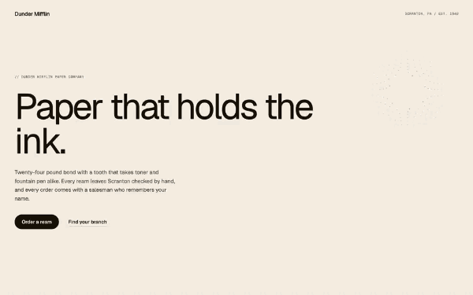

# Dot repel

A halftone screen of fine dots behind the hero, parted by the cursor and sprung back.



A screen of fine dots lies behind the hero, pale, like the halftone of a printed page, and the cursor parts it: the dots near the pointer are pushed out of a round hole, the nearest the farthest, so they pile up on its rim, which takes a little ink. When the pointer moves on, the dots spring back to their place with a slight overshoot and the screen closes again. Nothing but dots, no picture to load: one canvas under the section's content, clicks pass through, only the dots around the pointer are worked on, and the loop sleeps as soon as the field has settled, even with the pointer resting on it. A finger drag parts it too and a tap leaves a small ripple running out through the dots; under reduced motion the screen stays still and answers nothing.

## Files

| File | What it is |
|---|---|
| `dot-repel.js` | The engine, readable, no build step. Its settings are the `DEFAULTS` block at the top |
| `dot-repel.css` | The mechanics the engine needs, then the look of the preview, which is optional |
| `snippet.html` | The markup of the preview, with its attributes |
| `demo.html` | The preview as a page: open it in a browser |

## Use

```html
<link rel="stylesheet" href="dot-repel.css">
<!-- the markup of snippet.html -->
<script src="dot-repel.js"></script>
```

No dependency. The script mounts every `data-dot-repel` it finds on DOM ready and leaves `window.DotRepel` for the rest.

From a bundler, React or Next.js: `import { mount } from 'movingparts-free/dot-repel'`, see the README at the root.

## Settings

The defaults, as they stand at the top of the engine:

```js
var DEFAULTS = {
  color: '#15100c',     // Colour of the dots.
  rest: 0.12,           // 0 to 1. Opacity of a dot at rest.
  peak: 0.34,           // 0 to 1. Opacity of a dot pushed the farthest.
  spacing: 16,          // px, keep px. Distance between two dots.
  dot: 1.2,             // px, keep px. Radius of a dot at rest.
  reach: 'clamp(120px, 12vw, 180px)', // any CSS unit. Radius the pointer parts.
  grow: 1.35,           // times dot. Radius of a dot pushed the farthest.
  push: 0.28,           // times reach. How far the dots are pushed.
  life: 0.9,            // s. Time a dot takes to spring back.
};
```

The values themselves are never repeated here: they live in `DEFAULTS`, which
is the source, and the embed's settings block is lifted from it. This table
says what each key is for and what changing it does. `reach` accepts any CSS
unit, resolved by the browser; `spacing` and `dot` stay in px, so the grain
of the screen is the same on every screen.

| Key | What it is | Lower | Higher |
|---|---|---|---|
| `color` | Colour of the dots | Options: any CSS colour; taken out of this block, `--dot-repel-color` on the section takes over, then the ink `#15100c` | |
| `rest` | Opacity of a dot at rest, 0 to 1 | A screen you barely see until the pointer parts it | A plain dot grid that competes with the words |
| `peak` | Opacity of a dot pushed the farthest, the ones piled on the rim of the hole, 0 to 1; never under `rest` | The rim barely darker than the screen | A dark ring around the pointer |
| `spacing` | Distance between two dots of the grid, in px | A fine screen, more dots to redraw around the pointer | A coarse grid, the dots read one by one |
| `dot` | Radius of a dot at rest, in px; kept under half the spacing | Pin pricks | Heavy dots, a darker screen |
| `reach` | Radius of the area the pointer parts, any CSS unit | A small hole, only the dots right under the pointer move | A wide parting, the whole middle of the hero shifts |
| `grow` | Radius of a dot pushed the farthest, in times `dot` | The rim keeps the size of the screen | Swollen dots on the rim |
| `push` | How far the nearest dots are pushed, in times `reach`, 0 to 0.5 | A slight shift of the screen | A wide empty hole, the dots crowded on its edge |
| `life` | Time a dot takes to spring back once the pointer moves on, in seconds | A quick, tight return | A slow return that sways longer |

## Using it

- **One section, one attribute.** Put `data-dot-repel` on the section the
  field lies behind. The script adds a `<canvas>` of its own as the first
  child (class `dot-repel-layer`, `position: absolute; inset: 0;
  z-index: -1; pointer-events: none`, written inline as well as in the
  stylesheet, so the canvas is out of the flow before the stylesheet
  arrives). It switches a static section to `position: relative`, and gives
  the section a stacking context of its own with `isolation: isolate`, so
  the canvas sits over the section's background and under every word and
  link. It never takes a click.
- **The section needs a background of its own, or none.** The dots are drawn
  over the section's background colour; the page shows through where the
  section has none.
- **The sensitive area is the section, not the window**: coordinates are
  relative to its `getBoundingClientRect()`. An empty section is 0px tall and
  shows no dot; give it content or a height.
- **One setting for every field of the page**, without opening the file:
  declare `window.DotRepelSettings = { spacing: 12 }` in a script placed
  before `dot-repel.js`. The three levels, least specific first, are
  `DEFAULTS`, then that object, then a `data-dot-repel-*` attribute on the
  section itself (`data-dot-repel-reach="200px"`), so one section can still
  differ from the page-wide setting. The colour has one more level: without a
  `color` anywhere, the section's `--dot-repel-color` is read.
- **Touch**: a finger drag parts the field too, through touch events, once
  the finger has travelled 10px, and the page still scrolls under it. A short
  tap that barely moves leaves a ripple: a ring that runs out from the point
  and pushes the dots it crosses, then lets them spring back.
- **`prefers-reduced-motion`**: the screen of dots stays, still, and answers
  neither the pointer nor a tap. The engine listens to the setting and
  stops or starts with it.
- **Cost at rest is nothing**: the loop only runs while a dot is moving. It
  sleeps once the field has settled, the pointer resting on it included, and
  stops in a hidden tab. The section carries `data-dot-repel-state`: `live`
  while the loop runs, `idle` at rest, `still` under reduced motion, `held`
  for a frozen field.
- **A resize rebuilds the grid**: the window, or the section alone through a
  ResizeObserver. The field goes back to rest and `reach` is read again, so
  a `vw` or a `clamp()` follows the width.
- **From JavaScript**: `DotRepel.mount(el, overrides)` returns the instance,
  which carries `element`, `settings` (the values it resolved, `reach` in
  px), `resize()`, `ripple(x, y)` (the ripple of a tap at a point of the
  section), `clear()`, `frames()` and `isRunning()` (rendered frames since
  mount, and whether the loop runs, for a test that the loop sleeps), and
  `destroy()`. `destroy()` takes away the canvas, every listener, the size
  watch and the loop, and gives the section's `style` attribute back as it
  was, so the markup is as it was and mounting again starts clean.
  `DotRepel.destroy(el)` does the same from the element. In React, `mount`
  in `useEffect` and `destroy` in its cleanup; the double run of StrictMode
  then leaves one field, not two.
- `freeze()` holds the field as a still picture: the pointer leaving no
  longer closes the hole, the dots settle where the last move pushed them
  and the loop stops, so a held field costs nothing. `unfreeze()` lets the
  hole close again. `DotRepel.freeze(el)` and `DotRepel.unfreeze(el)` do the
  same from the element. It exists so a still image of the effect can be
  taken, a thumbnail that has to show the field parted at rest: a page that
  only wants the field never calls it.
- The words of the markup are the preview's, and they ship as they are:
  pasted, the page reads the way the preview did. Put the user's own
  content in their place whenever they want, in the page's language.
- **On Webflow, add the fonts first.** Add Geist and Geist Mono to your
  site's fonts (Site settings, Fonts, Google Fonts) before pasting: the paste
  names them, and the Designer drops a font the site does not have.

## Pitfalls when integrating

- **Settings handed to `mount()` after the page loaded are dropped.** `auto()`
  mounts on DOM ready, and `mount()` on a section that already carries a
  field returns the existing one untouched. A page-wide block therefore goes
  in `window.DotRepelSettings`, which `auto()` reads itself.
- **A child with a background of its own hides the dots under it.** The
  canvas is under the content: a card, a band or an image inside the section
  covers the screen where it stands, which is usually what is wanted.
- **A section with a `z-index` already has its stacking context**, so the
  script leaves `isolation` alone there. The canvas still sits under the
  content and over the background, since `z-index: -1` is read inside the
  section's own context.
- **Mouse and pen only for `pointermove`.** A touch pointer is ignored there
  on purpose, touch going through touch events; a page that fakes pointer
  events for a test has to give them `pointerType: 'mouse'`.

## The other formats

This folder is the code route. The same component exists as a Webflow paste (structure, classes and one Embed, ready for the Designer) and as a prompt for an AI assistant, on its page: [movingparts.supply/components/dot-repel/](https://movingparts.supply/components/dot-repel/?from=github).
