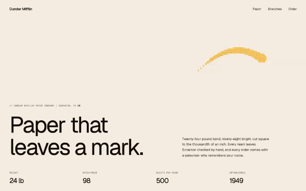

# Pixel ribbon

A ribbon of pixels trails the cursor on springs, then folds back into its head.



A ribbon of pixels trails the cursor, soft and liquid: it lies on the path the pointer has just taken, lags a little behind it and wobbles when the gesture turns. Under it is a chain of blobs, each one tied by a spring to where the pointer was a moment earlier, summed into one field on a pixel grid, so they melt into a single shape; the pixels at its rim are drawn smaller, a fringe that keeps changing shape as the chain moves. The ribbon swells with the travel of the pointer, and when the pointer stops it folds back into its head and deflates, the tail last. Nothing but pixels, no picture to load: one canvas over the section, clicks pass through, and the loop only runs while something is on screen. A finger drag traces it too and a tap throws the chain out as drops that pull back in; under reduced motion there is no ribbon at all.

## Files

| File | What it is |
|---|---|
| `pixel-ribbon.js` | The engine, readable, no build step. Its settings are the `DEFAULTS` block at the top |
| `pixel-ribbon.css` | The mechanics the engine needs, then the look of the preview, which is optional |
| `snippet.html` | The markup of the preview, with its attributes |
| `demo.html` | The preview as a page: open it in a browser |

## Use

```html
<link rel="stylesheet" href="pixel-ribbon.css">
<!-- the markup of snippet.html -->
<script src="pixel-ribbon.js"></script>
```

No dependency. The script mounts every `data-pixel-ribbon` it finds on DOM ready and leaves `window.PixelRibbon` for the rest.

From a bundler, React or Next.js: `import { mount } from 'movingparts-free/pixel-ribbon'`, see the README at the root.

## Settings

The defaults, as they stand at the top of the engine:

```js
var DEFAULTS = {
  color: '#ffab1a',     // Colour of the pixels.
  opacity: 1,           // 0 to 1. Opacity of the ribbon.
  cell: 6,              // px, keep px. Side of one pixel.
  size: 'clamp(9px, 0.82vw, 14px)', // any CSS unit. Radius of the ribbon at its head.
  life: 0.75,           // s. Time the ribbon takes to deflate at rest.
  burst: 2.2,           // times size. Reach of the drops a tap throws.
};
```

The values themselves are never repeated here: they live in `DEFAULTS`, which
is the source, and the embed's settings block is lifted from it. This table
says what each key is for and what changing it does. `size` accepts any CSS
unit, resolved by the browser; `cell` stays in px, so the grain is the same on
every screen.

| Key | What it is | Lower | Higher |
|---|---|---|---|
| `color` | Colour of the pixels of the ribbon | Options: any CSS colour; taken out of this block, `--pixel-ribbon-color` on the section takes over, then the amber `#ffab1a` | |
| `opacity` | Opacity of the whole ribbon, 0 to 1 | A faint trace over the words | A solid ribbon that hides what it crosses |
| `cell` | Side of one pixel of the grid the ribbon is drawn on, in px | A fine grain, the ribbon reads as a smooth stroke; more cells to fill each frame | Chunky blocks, the pixels show plainly and the rim steps |
| `size` | Radius of the ribbon at its head, any CSS unit; the tail is thinner | A thin thread; under about one `cell` nothing is drawn | A fat ribbon that swallows the words it crosses |
| `life` | How long the ribbon takes to deflate once the pointer slows, in seconds | It thins out almost at once and stays short | It stays swollen and folds back slowly |
| `burst` | Reach of the drops a tap throws, in times `size` | The drops barely leave the finger | The drops fly far before the springs pull them back |

## Using it

- **One section, one attribute.** Put `data-pixel-ribbon` on the section the
  ribbon runs over. The script adds a `<canvas>` of its own inside it (class
  `pixel-ribbon-layer`, `position: absolute; inset: 0; pointer-events: none`,
  written inline as well as in the stylesheet, so the canvas is out of the
  flow before the stylesheet arrives) and switches a static section to
  `position: relative`. The canvas goes over the content, which is what makes
  the effect, and never takes a click: links and buttons underneath keep
  working.
- **The sensitive area is the section, not the window**: coordinates are
  relative to its `getBoundingClientRect()`. An empty section is 0px tall and
  catches no pointer; give it content or a height.
- **One setting for every ribbon of the page**, without opening the file:
  declare `window.PixelRibbonSettings = { size: '18px' }` in a script placed
  before `pixel-ribbon.js`. The three levels, least specific first, are
  `DEFAULTS`, then that object, then a `data-pixel-ribbon-*` attribute on the
  section itself (`data-pixel-ribbon-cell="8"`), so one section can still
  differ from the page-wide setting. The colour has one more level: without a
  `color` anywhere, the section's `--pixel-ribbon-color` is read.
- **Touch**: a finger drag traces the ribbon too, through touch events, and
  the page still scrolls under it; the ribbon is drawn in section
  coordinates, so it stays where the finger passed. A short tap that barely
  moves throws the chain out from the point as drops, the springs slack at
  first, then firming up and pulling the drops back in.
- **`prefers-reduced-motion`**: no ribbon at all, not even a still dot. The
  pointer is the user's own cursor, and a mark that follows it is motion by
  nature. The engine listens to the setting and stops or starts with it.
- **Cost at rest is nothing**: the loop only runs while pixels are on screen,
  sleeps once the ribbon has deflated, and stops in a hidden tab. The
  section carries `data-pixel-ribbon-state`: `live` while the loop runs,
  `idle` at rest, `still` under reduced motion, `held` for a frozen ribbon.
- **From JavaScript**: `PixelRibbon.mount(el, overrides)` returns the
  instance, which carries `element`, `settings` (the lengths in px),
  `resize()`, `burst(x, y)` (the drops of a tap at a point of the section),
  `clear()`, `frames()` and `isRunning()` (rendered frames since mount, and
  whether the loop runs, for a test that the loop sleeps), and `destroy()`.
  `destroy()` takes away the canvas, every listener, the size watch and the
  loop, and gives back a `position` it had set, so the markup is as it was
  and mounting again starts clean. `PixelRibbon.destroy(el)` does the same
  from the element. In React, `mount` in `useEffect` and `destroy` in its
  cleanup; the double run of StrictMode then leaves one ribbon, not two.
- `freeze()` holds a ribbon as a still picture: what is on screen is taken
  off, then the next ribbon drawn is held a tenth of a second after the
  pointer pauses, lying on its path instead of folding in, and the loop
  stops, so a held ribbon costs nothing. `unfreeze()` takes the held ribbon
  off and lets the next one live out its normal life. `PixelRibbon.freeze(el)`
  and `PixelRibbon.unfreeze(el)` do the same from the element. It exists so a
  still image of the effect can be taken, a thumbnail that has to show a
  ribbon at rest: a page that only wants the ribbon never calls it.
- The words of the markup are the preview's, and they ship as they are:
  pasted, the page reads the way the preview did. Put the user's own
  content in their place whenever they want, in the page's language.
- **On Webflow, add the fonts first.** Add Geist and Geist Mono to your
  site's fonts (Site settings, Fonts, Google Fonts) before pasting: the paste
  names them, and the Designer drops a font the site does not have.

## Pitfalls when integrating

- **Settings handed to `mount()` after the page loaded are dropped.** `auto()`
  mounts on DOM ready, and `mount()` on a section that already carries a
  ribbon returns the existing one untouched. A page-wide block therefore goes
  in `window.PixelRibbonSettings`, which `auto()` reads itself.
- **Content stacked above `z-index: 3` covers the ribbon.** The canvas sits
  at `z-index: 3` inside the section. Content of the
  section with its own stacking context higher than that (a sticky header at
  `z-index: 10`, for one) is drawn over the ribbon, which then passes under
  it.
- **Mouse and pen only for `pointermove`.** A touch pointer is ignored there
  on purpose, touch going through touch events; a page that fakes pointer
  events for a test has to give them `pointerType: 'mouse'`.
- **The ribbon is not a cursor.** The system cursor stays where it is; hide
  it yourself with `cursor: none` on the section if the ribbon should be the
  only mark, and keep it on for links.

## The other formats

This folder is the code route. The same component exists as a Webflow paste (structure, classes and one Embed, ready for the Designer) and as a prompt for an AI assistant, on its page: [movingparts.supply/components/pixel-ribbon/](https://movingparts.supply/components/pixel-ribbon/?from=github).
